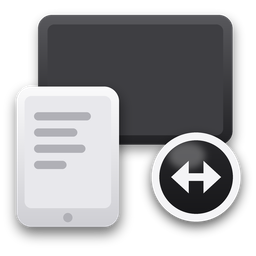

<p align="center"></p>

# DeskSpan

Use a phone, tablet, iPad or spare computer as a second screen for your Windows, macOS or Linux computer: **mirror** or **extend** your desktop over Wi-Fi or a cable, with touch and pen control and sound. The other device just opens a link in its browser: nothing to install there.

Part of **DeskLab**, free tools by the same developer: [getdesklab.com](https://getdesklab.com/).

> **Status: early development.** Pairing, the device list and the receiver page work; streaming your real screen (capture + encoding) is being built now. There is no release yet.

## How it will work

1. Open DeskSpan on the computer and press **Start sharing**.
2. On the phone or tablet, scan the QR code (or open the link and type the 6-digit code).
3. Allow the device on the computer, optionally with control (touch, pen, mouse).
4. The device now shows your screen. Allowed devices reconnect by themselves.

## Privacy and security

- Everything stays on your own network: no cloud, no account, no relay server. Video and input are encrypted by WebRTC.
- DeskSpan only listens while you share, and by default only on home/office network addresses and this computer (not VPNs or public addresses; you can turn VPNs on in Settings).
- Every new device needs the one-time QR link or code **and** your OK on the computer. Each allowed device gets its own key; the computer only stores a hash of it. Remove a device any time under Devices.
- Control of the computer is off for a device until you allow it.

## Plan

| | |
|---|---|
| 1 | Mirror a screen to a browser over Wi-Fi |
| 2 | Hardware encoding, low latency, several screens |
| 3 | Extend: virtual monitor on Windows ([Virtual Display Driver](https://github.com/VirtualDrivers/Virtual-Display-Driver), MIT), macOS and Linux |
| 4 | Touch, pen and keyboard back to the computer |
| 5 | Sound |
| 6 | Polish and first release; native Android/iOS apps with USB later |

## Develop

Needs Node 22+ and Rust (stable).

```sh
npm install
npm run tauri dev          # the app
npm run build              # app + receiver page (dist/, dist/receiver/)
npm test                   # unit tests
node tools/dev-host.mjs    # stand-in host for the receiver page (testing only)
```

Layout: `src/` the app's window (React), `receiver/` the page devices open (plain TypeScript), `src-tauri/` the Rust side (`server.rs` pairing + signalling, `devices.rs` allowed devices).

## Licence

MIT. Made by [Jagdeep Sandhu](https://github.com/imjagdeep).
